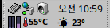

# R Weather

[English](README.md) | [한국어](README.ko.md) | [日本語](README.ja.md)

Haiku OS 用の Deskbar トレイ天気アイテムです。時計の隣に現在の天気と気温を表示し、
クリックすると詳しい天気と短い予報が出ます。



## pkgman でインストール

32 ビット x86 の Haiku(x86_gcc2)で:

```sh
pkgman add-repo https://pkgman.rainygirl.com/x86_gcc2
pkgman install rweather
rweather            # トレイに追加します。再起動後も表示されます
```

トレイから外すには `rweather --remove` を実行します。

`pkgman add-repo` が `Operation not supported` で失敗する場合、そのイメージの
ネットワークキットに TLS がありません。`http://pkgman.rainygirl.com/x86_gcc2` を使ってください。

## ソースからインストール

Haiku のマシンで:

```sh
make deploy         # ビルドして ~/config/non-packaged/bin にコピーし、トレイに追加します
```

地域はアイテムのメニューの **Location...** で変更します。天気データ:
[Open-Meteo.com](https://open-meteo.com) (CC BY 4.0)。

## AI 利用の告知

R Weather の一部は AI コーディングツール(Anthropic の Claude)の支援を受けて開発しました。
すべてのコードは作者がレビューし、テストしています。

## ライセンス

MIT。開発メモは [AGENTS.md](AGENTS.md) にあります。
