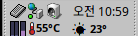

# R Weather

[English](README.md) | [한국어](README.ko.md) | [日本語](README.ja.md)

A Deskbar tray weather item for Haiku OS. It shows the current weather and
temperature next to the clock; click it for details and a short forecast.



## Install with pkgman

| Haiku | Add the repository |
| --- | --- |
| 32-bit x86 (x86_gcc2) | `pkgman add-repo https://pkgman.rainygirl.com/x86_gcc2` |
| x86_64 | `pkgman add-repo https://pkgman.rainygirl.com/x86_64` |
| arm64 | `pkgman add-repo http://pkgman.rainygirl.com/arm64` |

```sh
pkgman install rweather
rweather            # adds the item to the tray; it comes back after a reboot
```

To take it out of the tray: `rweather --remove`.

If `pkgman add-repo` fails with `Operation not supported`, the network kit of
that image has no TLS; use `http://` instead of `https://`.

## Install from source

On the Haiku machine:

```sh
make deploy         # builds, copies to ~/config/non-packaged/bin and adds it to the tray
```

Change the location from the item's menu (**Location...**). Weather data by
[Open-Meteo.com](https://open-meteo.com) (CC BY 4.0).

## AI disclosure

Parts of R Weather were developed with the assistance of AI coding tools
(Anthropic's Claude). All code has been reviewed and tested by the author.

## License

MIT. Development notes are in [AGENTS.md](AGENTS.md).
